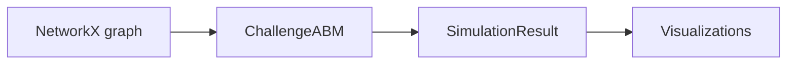

# ChallengeABM

ChallengeABM is a small agent-based model for studying challenge diffusion on a social network.

The workflow is:

1. Build or load a `networkx.Graph`.
2. Pass it to `ChallengeABM`.
3. Run the model.
4. Inspect the returned metrics and plots.

## Start Here

- [Usage](usage.md)
- [API Reference](api.md)
- [Visualization](visualization.md)
- [Model Notes](model.md)

## Simple Diagram




The arrows in the compartmental diagram mean:

- `U -> O`: awareness from nearby participation or amplification.
- `O -> P`: adoption of the challenge.
- `O -> C`: counteraction starts.
- `P -> A`: participation turns into amplification.
- `P -> D`: participation ends in dropout.
- `A -> D`: amplification ends in dropout.
- `C -> C` and `D -> D`: absorbing states in the current model.

## Minimal Example

```python
import networkx as nx

from challengeabm import ChallengeABM

graph = nx.watts_strogatz_graph(n=100, k=8, p=0.1, seed=42)
model = ChallengeABM(peer_network=graph)
result = model.run()

print(result.final_reach)
```
