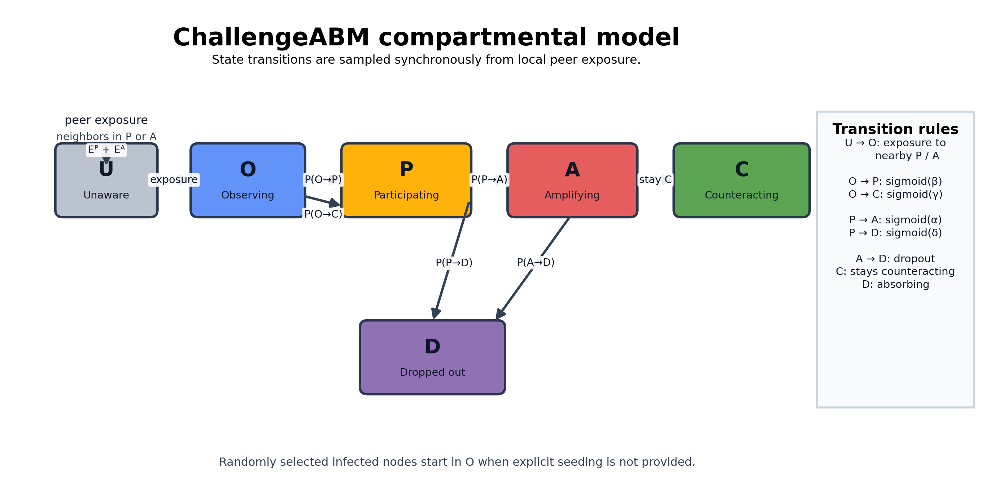

# Model Notes

ChallengeABM is intentionally minimal:

- the network is provided by the caller as a NetworkX graph;
- agents have four stable traits: susceptibility, conformity, risk aversion, and share tendency;
- the challenge has two abstract parameters: appeal and severity;
- behavior evolves through synchronous probabilistic state transitions.
- initial seeds can be selected randomly or passed explicitly as `infected_nodes`.
- stable agent traits are drawn from configurable distributions, with Beta as the default prior.

## Compartmental Diagram

The diagram is a compact summary of the synchronous transition rules. Each arrow is a one-step stochastic transition evaluated from the previous state snapshot.

### Transition Legend

- `U -> O`: awareness. An unaware agent becomes observing when local `P` or `A` exposure is high enough.
- `O -> P`: participation. Observing agents join the challenge when appeal, susceptibility, conformity, and exposure overcome resistance from risk aversion.
- `O -> C`: counteraction. Observing agents move into an opposing stance when risk aversion and local exposure favor resistance.
- `P -> A`: amplification. Participants start amplifying when sharing tendency, conformity, and exposure favor public promotion.
- `P -> D`: dropout. Participants leave the challenge when risk aversion and challenge severity outweigh retention.
- `A -> D`: dropout from amplification. Amplifiers can also exit using the same dropout logic applied to participants.
- `C -> C`: counteracting is absorbing in the current implementation.
- `D -> D`: dropped out is absorbing in the current implementation.

## States

- `U`: unaware
- `O`: observing
- `P`: participating
- `A`: amplifying
- `C`: counteracting
- `D`: dropped out

## Graph Handling

When a custom graph is passed to the model:

- it is copied before use;
- nodes are relabeled internally to `0..N-1`;
- missing edge weights default to `1.0`;
- the graph is converted to a simple undirected graph.

## Initial Seeding

If `infected_nodes` is provided to `ChallengeABM`, those node labels are used as the initial observing agents.

If not, the model chooses `seed_count` nodes at random.

## Outputs

The model reports:

- final reach;
- peak participation;
- time of peak participation;
- cascade duration;
- largest participating cluster;
- large-cascade indicator.

## Transition Parameters

Behavioral dynamics are controlled by `TransitionParameters`.

The parameters govern:

- awareness from local exposure;
- adoption from exposure, susceptibility, conformity, and challenge severity;
- amplification from share tendency and exposure;
- counteraction from risk aversion and exposure;
- dropout from risk aversion and exposure.
